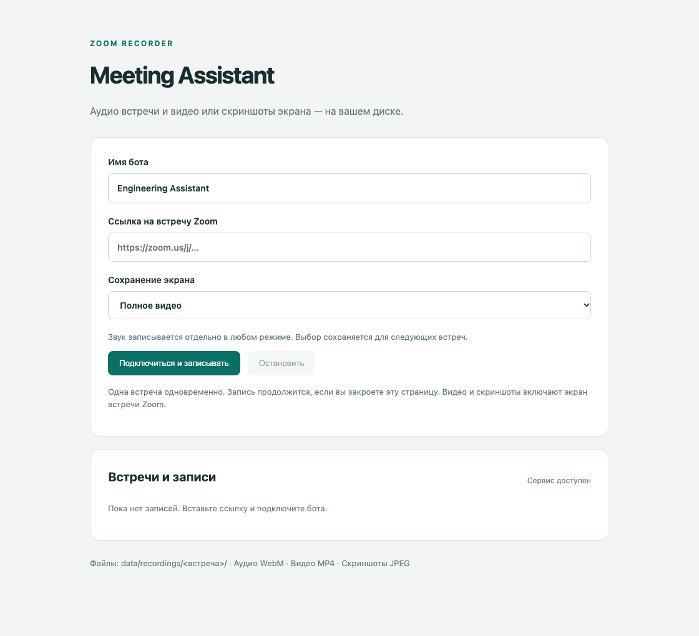
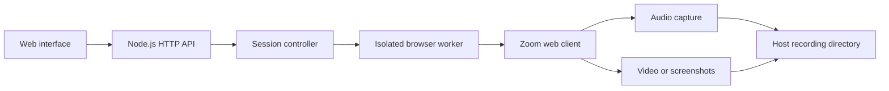

# Meeting Assistant

**Your Zoom recordings, on your own disk.**

A self-hosted Zoom recorder with a simple web interface. Join a meeting as a guest, capture audio separately, and choose full-screen video, timestamped screenshots, or audio only. Run it locally with Docker or on your own Linux server.

[Русский](README.ru.md) · [Validation notes](docs/validation.md) · [Third-party notices](THIRD_PARTY_NOTICES.md)



## Features

- **Separate audio and visuals** — Opus audio in WebM, plus H.264 video in MP4 or JPEG screenshots every fifteen seconds.
- **Screenshots linked to audio** — capture timestamps and audio offsets in JSON sidecars; screenshots crop to the visible shared-screen area when detected.
- **Persistent recordings** — files live on your host, survive container recreation, and can be downloaded from the interface.
- **Background sessions** — close the browser tab while recording continues; stop a session to finalize files and leave Zoom.
- **Recurring meetings** — choose weekdays, local time, time zone, bot name, and recording mode; the bot joins automatically while the service is running.
- **No service account or API key required** — no Vexa account, transcription provider, or calendar integration needed.

The default participant name is **Engineering Assistant**. You can change it in the interface independently of the application name.

## Quick start

Install and start Docker Desktop (macOS), or Docker Engine with Compose (Linux), then run from the project directory:

```sh
docker compose up --build -d
```

Open **http://localhost:8088**, click **Record a meeting**, enter a meeting name and Zoom meeting link, choose a recording mode, and start recording. Admit **Engineering Assistant** from the waiting room if needed. The host machine must remain awake and Docker must keep running.

To stop the application gracefully:

```sh
docker compose stop
```

Recordings stay in `./data/recordings/`. The Compose project and local image retain the internal name `engineering-assistant` to preserve compatibility with existing installations.

For a shared VM, set `RECORDINGS_DIR` to an absolute host directory and pass the same value to Meeting Analyzer. `ASSISTANT_DATA_DIR` separately selects the assistant's settings/schedule storage. Defaults preserve the existing local paths. See [shared storage setup](docs/shared-storage.md) for the VM example, mounts, and Linux file ownership.

## Recording modes

| Mode | Audio | Visuals |
| --- | --- | --- |
| Video | Separate `audio.webm` | `screen.mp4`, 1920 × 1080 at 15 fps, without audio |
| Screenshots | Separate `audio.webm` | JPEG every 15 seconds, with timing metadata |
| Audio only | `audio.webm` | None |

A detected screen share is cropped for screenshots; otherwise, the full meeting screen is captured. Overlays and thumbnails inside that region remain visible. Video captures the whole virtual Zoom screen.

Each session has its own directory, such as `PIM_Daily_<session-id>` for a scheduled meeting or `Meeting_<session-id>` for a manual recording with the default meeting name. The complete meeting name is saved as `meetingName` in `session.json`, fixed at launch even if the schedule is renamed later. Folder prefixes replace spaces and unsafe path characters with underscores and are length-limited; session UUIDs remain unchanged. Older UUID-only folders remain supported.

```text
data/recordings/<meeting-name>_<session-id>/
  session.json      # Session state and timing metadata
  audio.webm        # Finalized Opus audio
  audio-parts/      # Recovery chunks retained after finalization
  worker.log        # Connection and recording diagnostics
```

Depending on the selected mode, it also contains video or screenshots with `.jpg.json` sidecars. Sidecars include `capturedAtMs`, `captureCompletedAtMs`, `audioStartedAtMs`, and `audioOffsetMs`. Timing uses recording clocks and a capture window; it is not sample-accurate synchronization. Files marked `.partial` are unfinished output.

## Recurring meetings

Open **Schedule → Add meeting**, enter a meeting name, bot name (default **Engineering Assistant**), and Zoom link, select one or more weekdays, and choose the local time, IANA time zone (default `Europe/Moscow`), and recording mode. Rules can be edited, paused, resumed, or deleted. Deleting a rule keeps its existing recordings.

Each rule saves its own bot name, which can be changed when editing the meeting and is used for automatic launches independently of Settings. Existing rules without a bot name use **Engineering Assistant**.

The list shows the bot name, next launch, and most recent attempt. The service checks every ten seconds and launches within the scheduled minute. If another meeting is still active, the new occurrence is skipped rather than queued. Launches missed by a minute or more while the host was asleep or the service was stopped are skipped too. The service and Docker must stay running, but the browser page can be closed.

Rules and launch claims live in `data/schedules.json` and survive container recreation. Time zones are independent of the container's clock zone. Nonexistent times during daylight-saving transitions are skipped; repeated local times run once.

## How it works



Built with **TypeScript**, **Playwright / Chromium**, **FFmpeg**, and **Docker Compose**. Browser joining and audio chunking reuse code from [Vexa](https://github.com/Vexa-ai/vexa); this project supplies its own session management, local storage, capture pipeline, and web interface. See [third-party notices](THIRD_PARTY_NOTICES.md) for provenance and modifications.

## Run on a server

Copy the example configuration and edit it:

```sh
cp .env.example .env
```

Set `ACCESS_MODE=server` and a strong `APP_PASSWORD`, then start with Docker Compose. Basic Auth uses the username `assistant`. The default bind address is `127.0.0.1`; use an SSH tunnel or an HTTPS reverse proxy for remote access. Basic Auth requires HTTPS when sent across a network.

```sh
ssh -L 8088:127.0.0.1:8088 your-server
```

Open http://localhost:8088 on your computer. Recordings reside on the server; download them through the interface or copy them over SSH.

## Current scope

- One meeting at a time; standard Zoom `/j/<id>` and `/wc/...` links.
- The bot joins with its camera and microphone disabled. Guest-access restrictions, SSO, and CAPTCHA may prevent joining.
- The bot leaves automatically after two uninterrupted minutes alone in a meeting when the participant count is available.
- No automatic reconnection, transcription, summaries, or external calendar integration.
- No storage quota or automatic retention policy. Recovery chunks consume extra disk space.
- Interrupted sessions are marked as interrupted after restart; existing files remain available on disk.
- A real Zoom recording was validated on Apple Silicon on 2026-10-26. Linux VPS / amd64 validation remains pending. See [validation notes](docs/validation.md) for evidence and limitations.

## Development

Use **Node.js 22+** and install **FFmpeg / ffprobe**:

```sh
npm ci
npm test
npm run test:vendor
npm run build
```

| Directory | Purpose |
| --- | --- |
| `src/session` | Session state and worker lifecycle |
| `src/worker` | Browser automation and media capture |
| `src/recordings` | File writing and finalization |
| `src/server`, `public` | HTTP API and web interface |
| `vendor/vexa` | Attributed upstream browser and chunking modules |
| `tests` | Application tests |

## License

[Apache License 2.0](LICENSE). Upstream attribution and modifications are documented in [THIRD_PARTY_NOTICES.md](THIRD_PARTY_NOTICES.md).
