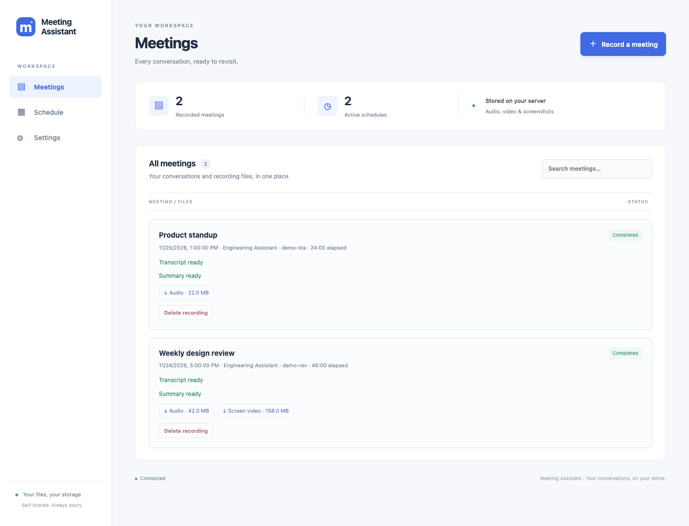
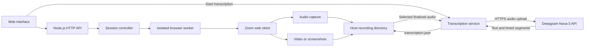

# Meeting Assistant

**Record Zoom meetings. Turn audio into timestamped transcripts. Keep the results on your own infrastructure.**

Meeting Assistant is a self-hosted application for recording and transcribing Zoom meetings. It joins as a guest, captures audio alongside video or timestamped screenshots, and turns completed recordings into readable transcripts through Deepgram Nova-3. Manage recordings, recurring meetings, and transcription from one web interface; deploy locally with Docker or on your own Linux server.

Recordings and transcripts are stored on your host. Transcription is optional: audio is sent to Deepgram only when you explicitly start processing. Recording itself requires no transcription API key.

[Validation notes](docs/validation.md) · [Third-party notices](THIRD_PARTY_NOTICES.md)



## Features

- **Separate audio and visuals** — Opus audio in WebM, plus H.264 video in MP4 or JPEG screenshots every fifteen seconds.
- **Screenshots linked to audio** — capture timestamps and audio offsets in JSON sidecars; screenshots crop to the visible shared-screen area when detected.
- **Persistent recordings** — files live on your host, survive container recreation, and can be downloaded from the interface.
- **Background sessions** — close the browser tab while recording continues; stop a session to finalize files and leave Zoom.
- **Recurring meetings** — choose weekdays, local time, time zone, bot name, and recording mode; the bot joins automatically while the service is running.
- **Deepgram transcription** — Nova-3 speech recognition with language selection, formatted text, timestamps, and optional speaker diarization. Click a timestamp to play the corresponding audio.
- **Persistent transcripts** — results and processing status are saved alongside each recording and remain available after a restart.
- **Optional external processing** — recording works without a Vexa account or transcription API key; configure your own Deepgram key when you need transcripts.

The default participant name is **Engineering Assistant**. You can change it in the interface independently of the application name.

## Quick start

Install and start Docker Desktop (macOS), or Docker Engine with Compose (Linux), then run from the project directory:

```sh
docker compose up --build -d
```

Open **http://localhost:8088**, click **Record a meeting**, enter a meeting name and Zoom meeting link, choose a recording mode, and start recording. Admit **Engineering Assistant** from the waiting room if needed. The host machine must remain awake and Docker must keep running.

To stop the application gracefully:

```sh
docker compose stop
```

Recordings stay in `./data/recordings/`. The Compose project and local image retain the internal name `engineering-assistant` to preserve compatibility with existing installations.

For a shared VM, set `RECORDINGS_DIR` to an absolute host directory and pass the same value to Meeting Analyzer. `ASSISTANT_DATA_DIR` separately selects the assistant's settings/schedule storage. Defaults preserve the existing local paths. See [shared storage setup](docs/shared-storage.md) for the VM example, mounts, and Linux file ownership.

## Recording modes

| Mode | Audio | Visuals |
| --- | --- | --- |
| Video | Separate `audio.webm` | `screen.mp4`, 1920 × 1080 at 15 fps, without audio |
| Screenshots | Separate `audio.webm` | JPEG every 15 seconds, with timing metadata |
| Audio only | `audio.webm` | None |

A detected screen share is cropped for screenshots; otherwise, the full meeting screen is captured. Overlays and thumbnails inside that region remain visible. Video captures the whole virtual Zoom screen.

Each session has its own directory, such as `PIM_Daily_<session-id>` for a scheduled meeting or `Meeting_<session-id>` for a manual recording with the default meeting name. The complete meeting name is saved as `meetingName` in `session.json`, fixed at launch even if the schedule is renamed later. Folder prefixes replace spaces and unsafe path characters with underscores and are length-limited; session UUIDs remain unchanged. Older UUID-only folders remain supported.

```text
data/recordings/<meeting-name>_<session-id>/
  session.json      # Session state and timing metadata
  audio.webm        # Finalized Opus audio
  audio-parts/      # Recovery chunks retained after finalization
  worker.log        # Connection and recording diagnostics
```

Depending on the selected mode, it also contains video or screenshots with `.jpg.json` sidecars. Sidecars include `capturedAtMs`, `captureCompletedAtMs`, `audioStartedAtMs`, and `audioOffsetMs`. Timing uses recording clocks and a capture window; it is not sample-accurate synchronization. Files marked `.partial` are unfinished output.

## Recurring meetings

Open **Schedule → Add meeting**, enter a meeting name, bot name (default **Engineering Assistant**), and Zoom link, select one or more weekdays, and choose the local time, IANA time zone (default `Europe/Moscow`), and recording mode. Rules can be edited, paused, resumed, or deleted. Deleting a rule keeps its existing recordings.

Each rule saves its own bot name, which can be changed when editing the meeting and is used for automatic launches independently of Settings. Existing rules without a bot name use **Engineering Assistant**.

The list shows the bot name, next launch, and most recent attempt. The service checks every ten seconds and launches within the scheduled minute. If another meeting is still active, the new occurrence is skipped rather than queued. Launches missed by a minute or more while the host was asleep or the service was stopped are skipped too. The service and Docker must stay running, but the browser page can be closed.

Each recurring meeting has an optional **Summary instructions** section. Enter a **Summary prompt** in any language, use **Insert example** for a starting point, or open **Expand editor** for longer instructions. Empty text uses the default instructions; custom prompts support up to 8,000 characters. **Save meeting** saves the prompt with the schedule, while **Cancel** discards changes. The expanded editor keeps its own draft: **Use instructions** applies it to the meeting form; Cancel or Escape leaves the form unchanged. The section shows the currently saved AI provider and model, with a link to AI settings.

At recording launch, the application copies the resolved instructions into `session.json` as `summaryPrompt`, with `summaryPromptSource` set to `default` or `custom`. Editing a schedule affects future recordings; earlier recordings retain their original instructions. Existing recordings without this metadata are left unchanged. This currently stores instructions for future summary generation; scheduling and saving prompts do not send content to OpenAI or z.ai or generate summaries.

Rules and launch claims live in `data/schedules.json` and survive container recreation. Time zones are independent of the container's clock zone. Nonexistent times during daylight-saving transitions are skipped; repeated local times run once.

## Deepgram settings

Open **Settings → Deepgram** to enter, show/hide, save, check or remove an API key. **Check connection** checks the entered key without saving it; an empty field uses the saved key. Saving does not verify connectivity. The server checks [Deepgram authentication](https://developers.deepgram.com/guides/fundamentals/authenticating) with a 10-second timeout, without uploading recordings. This confirms authentication only, not transcription permissions or available balance. Summaries are not implemented yet.

Credentials are encrypted with AES-256-GCM in `data/settings/api-keys.json`; the encryption key is stored separately in `data/secrets/master.key`. Directories use permissions `0700`, files `0600`. Both survive Docker container recreation in the existing `/data` volume and are excluded from Git and the Docker build context. If using `ASSISTANT_DATA_DIR` (or `DATA_DIR` outside Docker), these paths are relative to that directory. Back up both files together and protect the backup: access to both allows decryption. A missing or damaged master key must be restored from backup; it is never silently replaced while encrypted credentials exist. Saved API keys are never returned to the browser.

## AI provider settings

Open **Settings → AI models** to select **OpenAI** or **z.ai**, enter an API key, and save a model ID and reasoning effort preference. Each provider retains its own configuration and key when you switch. **Save AI settings** applies the provider selection; an empty key field preserves that provider's saved key. **Remove key** removes only the displayed provider's key and keeps its model preferences.

Suggested model IDs are starting points, not a complete catalogue or a guarantee of account access. You can enter an exact API model ID. Reasoning effort is a stored preference for future analysis; support depends on the model. Choose **Model default** if unsure.

**Check connection** checks the entered key without saving it, or uses the saved key when the field is empty. The server requests the provider's model list with a 10-second timeout and sends no meeting content. This does not test generation, selected-model capabilities, permissions for generation, or available balance. Provider references: [OpenAI models API](https://developers.openai.com/api/reference/resources/models/methods/list), [z.ai API and authentication](https://docs.z.ai/api-reference/introduction). z.ai uses its general API endpoint; GLM Coding Plan endpoints are not configured here.

AI keys and preferences use the same encrypted `data/settings/api-keys.json` storage and `data/secrets/master.key` as Deepgram. Existing Deepgram credentials remain compatible. Keys are never returned to the browser; back up both files together as described above.

This integration currently covers configuration and connection checks only. Meeting analysis and summary generation are not implemented; saving a provider or opening a meeting does not invoke a model.

## Meeting transcripts

Click a meeting title or the free area of its card to open **Recording / Transcription**. The card's transcript status opens Transcription directly. Existing download and delete buttons keep their own actions; browser Back and meeting links work.

After recording completes, open **Transcription**, select a finalized audio file, language (Russian by default), and optionally **Identify speakers** (off by default). **Get transcription** explicitly uploads the selected audio to [Deepgram's pre-recorded API](https://developers.deepgram.com/reference/speech-to-text/listen-pre-recorded), using Nova-3, smart formatting and utterances. Provider charges may apply. Viewing a meeting never uploads audio. One transcription can run at a time across the application; processing continues if the page is closed. A saved API key is required.

The transcript contains timestamps and, when enabled, speaker numbers rather than participant identities. Click a timestamp to seek and play the meeting audio. Results and job status persist in `transcription.json` alongside recording files. Failed retries keep the previous successful result. After a server restart an unfinished job is marked interrupted and is never automatically resubmitted: Deepgram may already have processed and charged for the first request. Review that state before manually retrying. Meetings cannot be deleted while their transcription is processing. Inputs are limited to finalized nonempty audio files up to 2 GB, with a request timeout of 11 minutes.

## How it works



The capture pipeline runs on your infrastructure. Speech recognition runs in Deepgram; the application saves the returned transcript locally and exposes it through the meeting page. Diarization distinguishes speakers by number; it does not identify Zoom participants. Summaries are not currently implemented.

Built with **TypeScript**, **Playwright / Chromium**, **FFmpeg**, and **Docker Compose**. Browser joining and audio chunking reuse code from [Vexa](https://github.com/Vexa-ai/vexa); this project supplies its own session management, local storage, capture pipeline, and web interface. See [third-party notices](THIRD_PARTY_NOTICES.md) for provenance and modifications.

## Run on a server

Copy the example configuration and edit it:

```sh
cp .env.example .env
```

Set `ACCESS_MODE=server` and a strong `APP_PASSWORD`, then start with Docker Compose. Basic Auth uses the username `assistant`. The default bind address is `127.0.0.1`; use an SSH tunnel or an HTTPS reverse proxy for remote access. Basic Auth requires HTTPS when sent across a network.

```sh
ssh -L 8088:127.0.0.1:8088 your-server
```

Open http://localhost:8088 on your computer. Recordings reside on the server; download them through the interface or copy them over SSH.

## Current scope

- One meeting at a time; standard Zoom `/j/<id>` and `/wc/...` links.
- The bot joins with its camera and microphone disabled. Guest-access restrictions, SSO, and CAPTCHA may prevent joining.
- The bot leaves automatically after two uninterrupted minutes alone in a meeting when the participant count is available.
- Transcription is manual; summaries and external calendar integration are not available.
- No storage quota or automatic retention policy. Recovery chunks consume extra disk space.
- Interrupted sessions are marked as interrupted after restart; existing files remain available on disk.
- A real Zoom recording was validated on Apple Silicon on 2026-10-26. Linux VPS / amd64 validation remains pending. See [validation notes](docs/validation.md) for evidence and limitations.

## Development

Use **Node.js 22+** and install **FFmpeg / ffprobe**:

```sh
npm ci
npm test
npm run test:vendor
npm run build
```

| Directory | Purpose |
| --- | --- |
| `src/session` | Session state and worker lifecycle |
| `src/worker` | Browser automation and media capture |
| `src/recordings` | File writing, finalization, and validated file access |
| `src/transcription` | Transcription jobs, provider requests, and persisted results |
| `src/integrations` | Deepgram credentials and connection checks |
| `src/server`, `public` | HTTP API and web interface |
| `vendor/vexa` | Attributed upstream browser and chunking modules |
| `tests` | Application tests |

## License

[Apache License 2.0](LICENSE). Upstream attribution and modifications are documented in [THIRD_PARTY_NOTICES.md](THIRD_PARTY_NOTICES.md).

## Connection retries

Network/browser connection failures and the observed Zoom browser bot block are retried within one meeting session, with four attempts maximum: immediately, then 10 seconds after the first failure, 10 seconds after the second, and 60 seconds after the third. Each failed browser is closed before the next attempt. **Stop recording** cancels connection and pending retries. Recording failures never trigger an automatic rejoin.

Explicit host rejection, ended meetings, authentication/passcode requirements, and admission waiting timeouts are not retried. New meeting cards show an expandable **Attempts: N/4** block with timestamps, outcomes, and detailed errors. Any failed attempt keeps this block red even after recovery. History is saved in `session.json`, with link passwords and bearer tokens redacted. Older sessions do not receive invented history. Restarting the application marks unfinished sessions interrupted rather than automatically rejoining.
