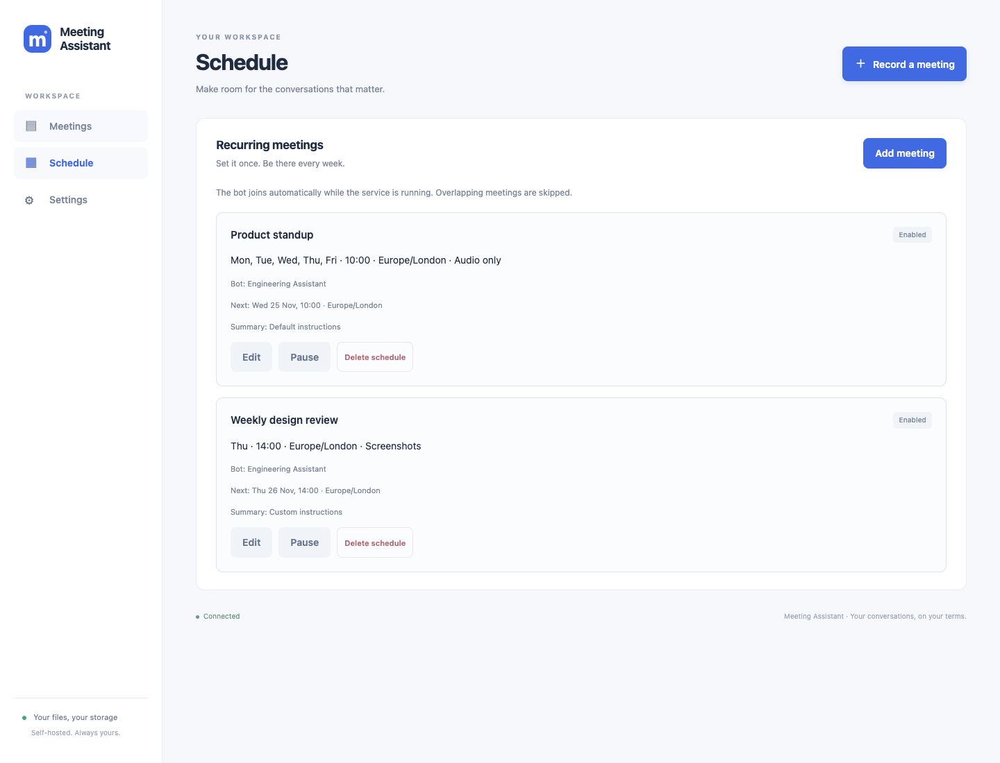
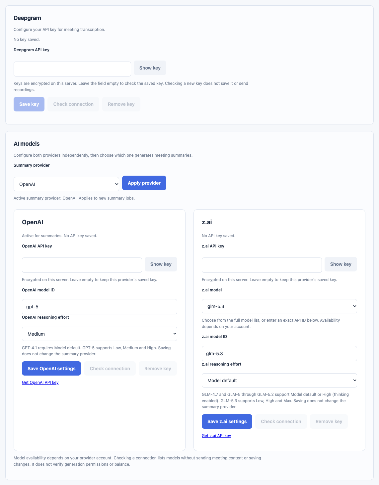
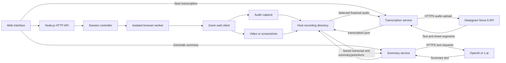

# Meeting Assistant

**Record Zoom meetings. Generate timestamped transcripts and meeting summaries. Keep the results on your own infrastructure.**

Meeting Assistant is a self-hosted application for recording and transcribing Zoom meetings. It joins as a guest or with an optional Zoom account, captures audio alongside video or timestamped screenshots, and turns completed recordings into readable transcripts through Deepgram Nova-3. Generate summaries from saved transcripts with OpenAI or z.ai. Manage recordings, recurring meetings, transcription, and summaries from one web interface; deploy locally with Docker or on your own Linux server.

Recordings, transcripts, and summaries are stored on your host. External processing is optional: audio is sent to Deepgram only when you start transcription, and transcript text is sent to OpenAI or z.ai only when you start summary generation. Recording itself requires no transcription API key.

[Validation notes](docs/validation.md) · [Third-party notices](THIRD_PARTY_NOTICES.md)


## Features

- **Separate audio and visuals** — Opus audio in WebM, plus H.264 video in MP4 or JPEG screenshots every fifteen seconds.
- **Screenshots linked to audio** — capture timestamps and audio offsets in JSON sidecars; screenshots crop to the visible shared-screen area when detected.
- **Persistent recordings** — files live on your host, survive container recreation, and can be downloaded from the interface.
- **Background sessions** — close the browser tab while recording continues; stop a session to finalize files and leave Zoom.
- **Recurring meetings** — choose weekdays, local time, time zone, bot name, and recording mode; the bot joins automatically while the service is running.
- **Optional Zoom account** — sign in from Settings, complete additional verification in the server browser, and reuse an encrypted session across container restarts. Meeting names remain configurable when Zoom permits renaming.
- **Deepgram transcription** — Nova-3 speech recognition with language selection, formatted text, timestamps, and optional speaker diarization. Click a timestamp to play the corresponding audio.
- **Persistent transcripts** — results and processing status are saved alongside each recording and remain available after a restart.
- **Meeting summaries** — manually generate summaries through OpenAI or z.ai, with per-meeting instructions, full-transcript chunking for long meetings, saved results, copying, and Markdown downloads.
- **Optional external processing** — recording works without a Vexa account or transcription API key; configure your own Deepgram key when you need transcripts.

The default participant name is **Engineering Assistant**. You can change it in the interface independently of the application name.

## Quick start

Install and start Docker Desktop (macOS), or Docker Engine with Compose (Linux), then run from the project directory:

```sh
docker compose up --build -d
```

Open **http://localhost:8088**, click **Record a meeting**, enter a meeting name and Zoom meeting link, choose a recording mode, and start recording. Admit **Engineering Assistant** from the waiting room if needed. The host machine must remain awake and Docker must keep running.

To stop the application gracefully:

```sh
docker compose stop
```

Recordings stay in `./data/recordings/`. The Compose project and local image retain the internal name `engineering-assistant` to preserve compatibility with existing installations.

For a shared VM, set `RECORDINGS_DIR` to an absolute host directory and pass the same value to Meeting Analyzer. `ASSISTANT_DATA_DIR` separately selects the assistant's settings/schedule storage. Defaults preserve the existing local paths. See [shared storage setup](docs/shared-storage.md) for the VM example, mounts, and Linux file ownership.

## Recording modes

| Mode | Audio | Visuals |
| --- | --- | --- |
| Video | Separate `audio.webm` | `screen.mp4`, 1920 × 1080 at 15 fps, without audio |
| Screenshots | Separate `audio.webm` | JPEG every 15 seconds, with timing metadata |
| Audio only | `audio.webm` | None |

A detected screen share is cropped for screenshots; otherwise, the full meeting screen is captured. Overlays and thumbnails inside that region remain visible. Video captures the whole virtual Zoom screen.

Each session has its own directory, such as `PIM_Daily_<session-id>` for a scheduled meeting or `Meeting_<session-id>` for a manual recording with the default meeting name. The complete meeting name is saved as `meetingName` in `session.json`, fixed at launch even if the schedule is renamed later. Folder prefixes replace spaces and unsafe path characters with underscores and are length-limited; session UUIDs remain unchanged. Older UUID-only folders remain supported.

```text
data/recordings/<meeting-name>_<session-id>/
  session.json      # Session state and timing metadata
  audio.webm        # Finalized Opus audio
  audio-parts/      # Recovery chunks retained after finalization
  worker.log        # Connection and recording diagnostics
```

Depending on the selected mode, it also contains video or screenshots with `.jpg.json` sidecars. Sidecars include `capturedAtMs`, `captureCompletedAtMs`, `audioStartedAtMs`, and `audioOffsetMs`. Timing uses recording clocks and a capture window; it is not sample-accurate synchronization. Files marked `.partial` are unfinished output.

## Recurring meetings

Choose when the bot joins each recurring meeting, with separate weekdays, times, time zones, and recording modes. The screenshot below uses fictional demonstration meetings.



Open **Schedule → Add meeting**, enter a meeting name, bot name (default **Engineering Assistant**), and Zoom link, select one or more weekdays, and choose the local time, IANA time zone (default `Europe/Moscow`), and recording mode. Rules can be edited, paused, resumed, or deleted. Deleting a rule keeps its existing recordings.

Each rule saves its own bot name, which can be changed when editing the meeting and is used for automatic launches independently of Settings. Existing rules without a bot name use **Engineering Assistant**.

The list shows the bot name, next launch, and most recent attempt. The service checks every ten seconds and launches within the scheduled minute. If another meeting is still active, the new occurrence is skipped rather than queued. Launches missed by a minute or more while the host was asleep or the service was stopped are skipped too. The service and Docker must stay running, but the browser page can be closed.

Each recurring meeting has an optional **Summary instructions (prompt)** section. Enter a **Summary prompt** in any language, use **Insert example** for a starting point, or open **Expand editor** for longer instructions. Empty text uses the default instructions; custom prompts support up to 8,000 characters. **Save meeting** saves the prompt with the schedule, while **Cancel** discards changes. The expanded editor keeps its own draft: **Use instructions** applies it to the meeting form; Cancel or Escape leaves the form unchanged. The section shows the currently saved AI provider and model, with a link to AI settings.

At recording launch, the application saves the schedule ID and a fallback instruction snapshot in `session.json`. Each new summary generation, including **Generate again** for an existing linked recording, uses the latest instructions saved in that schedule. Editing instructions does not change a running job or an already saved summary. If the schedule is deleted, generation falls back to the recording’s saved instructions, or the default when no snapshot exists. Legacy recordings can be linked from the schedule’s recorded last-launch session ID; names alone are never used to guess a link. Scheduling and saving prompts do not send content to OpenAI or z.ai or generate summaries.

Rules and launch claims live in `data/schedules.json` and survive container recreation. Time zones are independent of the container's clock zone. Nonexistent times during daylight-saving transitions are skipped; repeated local times run once.

## Zoom account settings

Connecting a Zoom account is optional. Register a separate Zoom account specifically
for the bot and use that account’s email and password here, rather than your personal
credentials. Signing up is straightforward. An authenticated session may improve the
bot’s chances of passing Zoom’s checks and joining meetings, but does not guarantee
admission. Without a connected account, the bot joins as a guest.

Open **Settings → Zoom account**, enter the bot account’s email and password, and click
**Connect**. The application attempts sign-in and confirms access to the account
profile before showing **Connected**. Connecting does not join or record a meeting.
The password is used only for that attempt and is not saved. Authentication does
not guarantee meeting admission: Zoom and the meeting host can still refuse entry.

If Zoom requests a verification code, CAPTCHA, SSO, or another manual step, choose
**Continue in browser**. The interactive view shows the browser running on your
server, including when Docker runs on a remote VM. Click the image to focus a field
and type, or click a field and use **Replace field** or **Clear field**. The replacement control replaces its contents instead of appending. A separate browser on your own computer
cannot authorize the container. Closing this view leaves sign-in pending;
**Cancel sign-in** ends it. Pending sign-in expires after fifteen minutes.

**Check connection** verifies the saved session without entering a meeting.
**Reconnect** starts a new sign-in; **Disconnect** removes the saved account.
When a password is saved, its field shows a mask: leave it unchanged to reconnect
with the server-stored password, or enter a new password. Changing the email requires
a password for that account. The saved password itself is never sent to the browser.
An expired session triggers one automatic sign-in with the saved password before
another meeting connection attempt. If Zoom requests a verification code or CAPTCHA,
or rejects the credentials, reconnect in Settings. Accounts connected before password
storage was added require one manual reconnect to save their password.
Disconnecting or reconnecting does not change a recording already in progress.
With no connected account, the bot uses the original guest flow.

The password and verified session are encrypted in `data/settings/api-keys.json` using the
existing `data/secrets/master.key`. Preserve both through the `/data` volume and
back them up together. The session survives container restart/recreation when this
volume is retained, but Zoom controls its expiration and may require another sign-in.
The saved password is never returned through the settings API. Disconnect removes
the saved password and session. No VNC port or Chromium debugging port is exposed.
On a remote server, use HTTPS or the SSH tunnel described below for application access.

Each meeting's **Bot name** is applied in pre-join when possible. The bot also
attempts in-meeting renaming if necessary. If Zoom prevents or cannot confirm the
change, the recording shows a warning that the account name may remain visible.
The global Zoom account name is never changed. Explicit bot prohibitions stop
connection retries; they are not reported as a proven requirement to use RTMS.

## Deepgram settings

Configure Deepgram for transcription and OpenAI or z.ai models for meeting summaries. This settings screenshot uses demonstration model preferences and contains no API keys.



Open **Settings → Deepgram** to enter, show/hide, save, check or remove an API key. **Check connection** checks the entered key without saving it; an empty field uses the saved key. Saving does not verify connectivity. The server checks [Deepgram authentication](https://developers.deepgram.com/guides/fundamentals/authenticating) with a 10-second timeout, without uploading recordings. This confirms authentication only, not transcription permissions or available balance.

Credentials are encrypted with AES-256-GCM in `data/settings/api-keys.json`; the encryption key is stored separately in `data/secrets/master.key`. Directories use permissions `0700`, files `0600`. Both survive Docker container recreation in the existing `/data` volume and are excluded from Git and the Docker build context. If using `ASSISTANT_DATA_DIR` (or `DATA_DIR` outside Docker), these paths are relative to that directory. Back up both files together and protect the backup: access to both allows decryption. A missing or damaged master key must be restored from backup; it is never silently replaced while encrypted credentials exist. Saved API keys are never returned to the browser.

## AI provider settings

Open **Settings → AI models** to configure the separate **OpenAI** and **z.ai** cards. Both providers can retain a saved API key, model ID, and reasoning preference at the same time. **Save OpenAI settings** and **Save z.ai settings** save only that provider’s configuration and do not change which provider generates summaries. An empty key field preserves that provider’s saved key; **Remove key** affects only its own card and keeps model preferences. Select **Summary provider** and click **Apply provider** to switch between saved configurations. Switching preserves both configurations and any unsaved card drafts; it applies to new summary jobs.

The **z.ai model** dropdown always shows the full suggested list, including GLM-5, GLM-5.1, GLM-5.2, GLM-5.3 and GLM-5.3 Flash/FlashX; it is not filtered by the currently saved model ID. The model ID field remains editable for custom IDs. Suggested model IDs are starting points, not a complete catalogue or a guarantee of account access. You can enter an exact API model ID. Reasoning effort is applied when generating summaries; support depends on the model. Choose **Model default** if unsure. GPT-5 supports Low/Medium/High; GLM-5.3 supports Low/High/Max. GLM-4.7 and GLM-5 through GLM-5.2 support Model default or High (thinking enabled), rather than numeric depth levels. GPT-4.1 and unlisted models require Model default. Unsupported combinations are rejected before generation requests.

**Check connection** checks the entered key without saving it, or uses the saved key when the field is empty. The server requests the provider's model list with a 10-second timeout and sends no meeting content. This does not test generation, selected-model capabilities, permissions for generation, or available balance. Provider references: [OpenAI models API](https://developers.openai.com/api/reference/resources/models/methods/list), [z.ai API and authentication](https://docs.z.ai/api-reference/introduction). z.ai uses its general API endpoint; GLM Coding Plan endpoints are not configured here.

AI keys and preferences use the same encrypted `data/settings/api-keys.json` storage and `data/secrets/master.key` as Deepgram. Existing Deepgram credentials remain compatible. Keys are never returned to the browser; back up both files together as described above.

Saving a provider or opening a meeting does not invoke a model. Start paid generation explicitly from the meeting’s **Summary** tab.

## Meeting transcripts

Click a meeting title or the free area of its card to open **Recording / Transcription / Summary**. The card's transcript status opens Transcription directly. Existing download and delete buttons keep their own actions; browser Back and meeting links work.

After recording completes, open **Transcription**, select a finalized audio file, language (Russian by default), and optionally **Identify speakers** (off by default). **Get transcription** explicitly uploads the selected audio to [Deepgram's pre-recorded API](https://developers.deepgram.com/reference/speech-to-text/listen-pre-recorded), using Nova-3, smart formatting and utterances. Provider charges may apply. Viewing a meeting never uploads audio. One transcription can run at a time across the application; processing continues if the page is closed. A saved API key is required.

The transcript contains timestamps and, when enabled, speaker numbers rather than participant identities. Click a timestamp to seek and play the meeting audio. Results and job status persist in `transcription.json` alongside recording files. Failed retries keep the previous successful result. After a server restart an unfinished job is marked interrupted and is never automatically resubmitted: Deepgram may already have processed and charged for the first request. Review that state before manually retrying. Meetings cannot be deleted while their transcription is processing. Inputs are limited to finalized nonempty audio files up to 2 GB, with a request timeout of 11 minutes.

## Meeting summaries

After transcription completes, open the meeting’s **Summary** tab and click **Generate summary**. The server sends the full saved transcript, anonymous speaker turns when diarization is available, and this recording’s summary instructions to the selected OpenAI or z.ai model using its saved API key. Audio, video, and screenshots are not sent to the summary provider. Generation never starts automatically after recording, transcription, or navigation. A nonempty completed transcript is required.

The default instructions request key points, decisions, action items, and open questions in the meeting’s primary language, without inventing owners, deadlines, or facts. Linked recurring meetings use the latest prompt from Schedule each time generation starts. Unlinked recordings use their recording snapshot or the default instructions. The Summary tab shows **Current instructions (prompt)** and **Instructions (prompt) for next generation** before submission; the saved result separately retains **Instructions (prompt) used for this summary**. For a linked recurring meeting, **Edit instructions (prompt)** opens the shared schedule prompt directly from the meeting page. The editor warns that **Save shared prompt** affects future summary generations for all recordings of that meeting type, including existing recordings. Cancel or Escape discards the draft. Empty text selects the default instructions; the limit is 8,000 characters. If someone changes the saved prompt while the editor is open, saving returns a conflict and keeps the draft rather than overwriting the newer prompt. The saved model, reasoning preference, instructions, and transcript fingerprint identify the input used for each result. Editing provider settings or schedules does not modify a running job or a saved result.

Short transcripts use one request. Longer transcripts are split into ordered parts, summarized into notes, then merged, recursively if necessary. All transcript text is included in source requests; the end of the meeting is never silently discarded. Summarization is lossy and may omit or misinterpret details: review decisions and commitments against the transcript. Multi-step generation costs additional requests and takes longer. The context budget reserves space for instructions, message framing, output and reasoning, plus a safety margin. UTF-8 byte counts provide a conservative token bound, which may cause splitting earlier than necessary. Explicit policies cover GPT-4.1, GPT-5, GLM-4.7, GLM-5, GLM-5.1, GLM-5.2 and GLM-5.3 families; other IDs use a conservative 16,384-token context and 4,096-token output budget, displayed on the saved result. Smaller-context unlisted models may still reject a request.

One summary can run at a time across the application. Processing continues after you leave the page. **Copy summary** copies the original Markdown; **Download Markdown** downloads the saved text. **Generate again** requires confirmation and uses the current completed transcript, saved AI settings, and the latest instructions from the linked schedule (or the recording/default fallback for unlinked recordings). Failed regeneration preserves the previous successful summary. A notice identifies results based on an earlier transcript or earlier instructions. Transcription and deletion of the same meeting are blocked during generation.

State and results are saved atomically in `summary.json` alongside the recording files. After a server restart unfinished jobs are marked interrupted; there are no automatic paid retries or resumptions. The provider may already have processed and charged for pending requests, even when a job fails. Limits: 8 MiB of source text including speaker turns, at most 64 provider requests per job, 11 minutes per request, and 2 MiB per provider response. Empty, refused, malformed, or output-limited responses fail explicitly; incomplete summaries do not replace the last successful result. If notes cannot be reduced to fit, select another model and generate again.

## How it works



The capture pipeline runs on your infrastructure. Speech recognition runs in Deepgram; the application saves the returned transcript locally and exposes it through the meeting page. Diarization distinguishes speakers by number; it does not identify Zoom participants. Summary generation runs through the selected OpenAI or z.ai API, with the returned text and provenance saved locally.

Built with **TypeScript**, **Playwright / Chromium**, **FFmpeg**, and **Docker Compose**. Browser joining and audio chunking reuse code from [Vexa](https://github.com/Vexa-ai/vexa); this project supplies its own session management, local storage, capture pipeline, and web interface. See [third-party notices](THIRD_PARTY_NOTICES.md) for provenance and modifications.

## Run on a server

Copy the example configuration and edit it:

```sh
cp .env.example .env
```

Set `ACCESS_MODE=server` and a strong `APP_PASSWORD`, then start with Docker Compose. Basic Auth uses the username `assistant`. The default bind address is `127.0.0.1`; use an SSH tunnel or an HTTPS reverse proxy for remote access. Basic Auth requires HTTPS when sent across a network.

```sh
ssh -L 8088:127.0.0.1:8088 your-server
```

Open http://localhost:8088 on your computer. Recordings reside on the server; download them through the interface or copy them over SSH.

## Current scope

- One meeting at a time; standard Zoom `/j/<id>` and `/wc/...` links.
- The bot joins with its camera and microphone disabled. Guest-access restrictions, SSO, and CAPTCHA may prevent joining.
- The bot leaves automatically after two uninterrupted minutes alone in a meeting when the participant count is available.
- Transcription is manual; summaries and external calendar integration are not available.
- No storage quota or automatic retention policy. Recovery chunks consume extra disk space.
- Interrupted sessions are marked as interrupted after restart; existing files remain available on disk.
- A real Zoom recording was validated on Apple Silicon on 2026-10-26. Linux VPS / amd64 validation remains pending. See [validation notes](docs/validation.md) for evidence and limitations.

## Development

Use **Node.js 22+** and install **FFmpeg / ffprobe**:

```sh
npm ci
npm test
npm run test:vendor
npm run build
```

| Directory | Purpose |
| --- | --- |
| `src/session` | Session state and worker lifecycle |
| `src/worker` | Browser automation and media capture |
| `src/recordings` | File writing, finalization, and validated file access |
| `src/transcription` | Transcription jobs, provider requests, and persisted results |
| `src/integrations` | Deepgram credentials and connection checks |
| `src/server`, `public` | HTTP API and web interface |
| `vendor/vexa` | Attributed upstream browser and chunking modules |
| `tests` | Application tests |

## License

[Apache License 2.0](LICENSE). Upstream attribution and modifications are documented in [THIRD_PARTY_NOTICES.md](THIRD_PARTY_NOTICES.md).

## Connection retries

Transient network/browser connection failures are retried within one meeting session, with four attempts maximum: immediately, then 10 seconds after the first failure, 10 seconds after the second, and 60 seconds after the third. Each failed browser is closed before the next attempt. **Stop recording** cancels connection and pending retries. Recording failures never trigger an automatic rejoin.

Authentication failures allow one automatic sign-in with saved credentials followed by an immediate connection retry within the four-attempt limit. Explicit browser bot prohibitions, host rejection, ended meetings, meeting passcode requirements, and admission waiting timeouts are not retried. New meeting cards show an expandable **Attempts: N/4** block with timestamps, outcomes, and detailed errors. Any failed attempt keeps this block red even after recovery. History is saved in `session.json`, with link passwords and bearer tokens redacted. Older sessions do not receive invented history. Restarting the application marks unfinished sessions interrupted rather than automatically rejoining.
