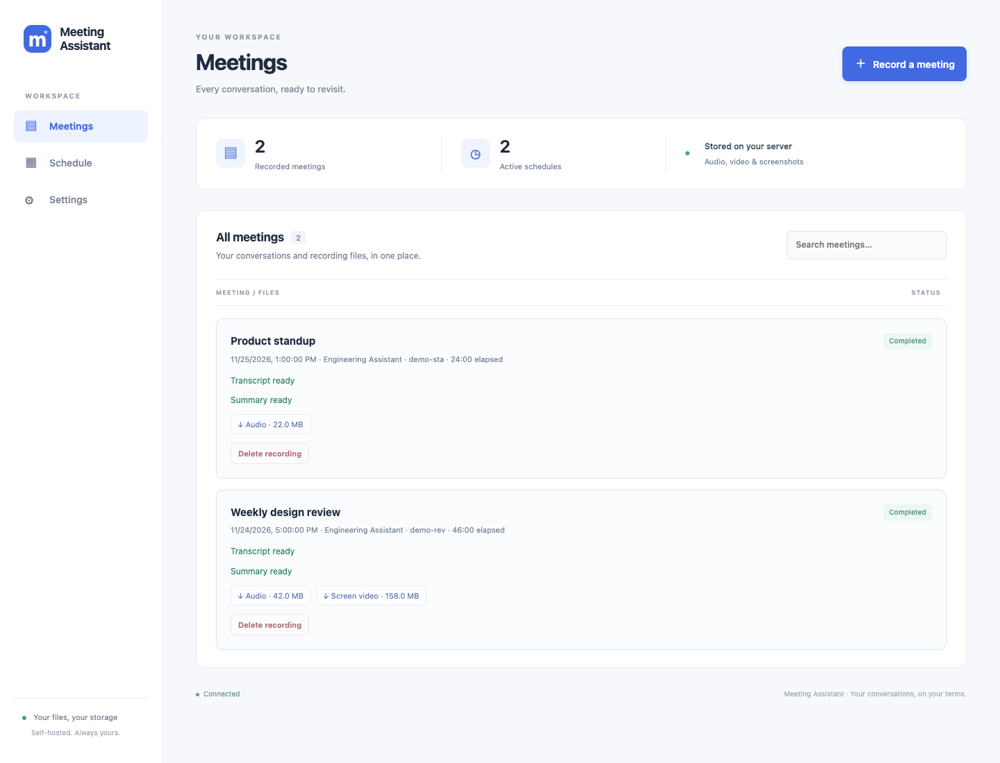
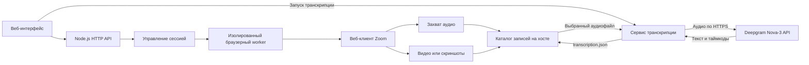

# Meeting Assistant

**Запись Zoom-встреч, транскрипция аудио и хранение результатов на вашей инфраструктуре.**

Meeting Assistant — приложение для записи и транскрипции Zoom-встреч с развёртыванием на собственном компьютере или сервере. Бот подключается как гость, сохраняет аудио отдельно от видео или скриншотов, а интеграция с Deepgram Nova-3 преобразует готовую запись в текст с таймкодами. Записи, расписание встреч и транскрипция доступны в едином веб-интерфейсе; приложение запускается через Docker Compose.

Аудио, видео, скриншоты и готовые транскрипции хранятся на вашем диске. Распознавание речи выполняется в Deepgram: выбранный аудиофайл отправляется провайдеру только после явного запуска обработки. Для самой записи API-ключ не требуется.

[English](README.md) · [Результаты проверок](docs/validation.md) · [Сторонние компоненты](THIRD_PARTY_NOTICES.md)



## Возможности

- **Три режима записи** — отдельное аудио Opus в WebM и видео H.264 в MP4, скриншоты JPEG каждые 15 секунд или только аудио.
- **Привязка скриншотов к аудио** — временные метки в JSON; при обнаружении демонстрации сохраняется её видимая область.
- **Транскрипция через Deepgram Nova-3** — выбор языка, форматирование текста, таймкоды и опциональное разделение реплик по говорящим. Нажатие на таймкод запускает соответствующий фрагмент аудио.
- **Сохранение результатов** — файлы записи, транскрипция и статус обработки доступны после перезапуска приложения.
- **Регулярные встречи** — расписание по дням недели с выбором времени, часового пояса, имени бота и режима записи.
- **Фоновая работа** — запись и транскрипция продолжаются после закрытия вкладки браузера, пока приложение работает.
- **Собственная инфраструктура** — локальный запуск или Linux-сервер; интеграция с Deepgram подключается вашим API-ключом в настройках.

Имя участника по умолчанию — **Engineering Assistant**. Его можно изменить независимо от названия приложения.

## Быстрый запуск

Установите и запустите Docker Desktop на macOS или Docker Engine с Compose на Linux. В каталоге проекта выполните:

```sh
docker compose up --build -d
```

Открыть http://localhost:8088. Нажать **Record a meeting**, задать название встречи и вставить обычную HTTPS-ссылку Zoom с паролем в query, если он требуется. При наличии комнаты ожидания допустить **Engineering Assistant** во встречу. Сессия продолжается после закрытия вкладки; Mac не должен засыпать, Docker должен работать.

Записи находятся в `./data/recordings/<название-встречи>_<UUID>/` рядом с compose.yaml и доступны для скачивания через страницу. `session.json` содержит время начала аудио/видео для сопоставления. Само видео содержит камеры и интерфейс, если они видны в Zoom; автоматического выделения демонстрации нет.

- `audio.webm`: готовое аудио Opus; открывается в Chrome/VLC и используется встроенной транскрипцией Deepgram.
- `screen.mp4`: H.264, 1920×1080, 15 fps, без аудиодорожки.
- `audio-parts/`: исходные аудиофрагменты для восстановления; сохраняются после финализации, занимают дополнительное место.
- `*.partial.*`: незавершённые данные после сбоя, не выдаются за готовые записи.
- `worker.log`: журнал подключения/записи; пароли из Zoom URL маскируются.

Остановка кнопкой сохраняет файлы, затем явно выходит из Zoom. Остановка контейнера также ожидает завершения записи:

```sh
docker compose stop
```

Списки встреч, имя и записи сохраняются при `docker compose down` и повторном запуске: они на диске хоста. Старый worker после аварии не запускается автоматически; сессия помечается «Прервана». После начала записи автоматического переподключения нет; повторы на этапе подключения описаны ниже.

## Linux VPS

Тот же проект собирается и запускается Docker Compose. Перед удалённым доступом скопировать `.env.example` в `.env`, установить `ACCESS_MODE=server` и сильный `APP_PASSWORD`. Имя для Basic Auth: `assistant`. По умолчанию порт опубликован только на 127.0.0.1; рекомендуется оставить его закрытым и использовать SSH-туннель либо HTTPS reverse proxy. Не передавать пароль Basic Auth через открытый HTTP.

Через SSH-туннель с Mac:

```sh
ssh -L 8088:127.0.0.1:8088 your-server
```

После этого открыть http://localhost:8088. На VPS файлы хранятся в `data/recordings` проекта **на сервере**, а не автоматически на Mac; скачать можно из интерфейса либо скопировать по SSH. Монтирование каталога сохраняет данные при пересоздании контейнера, но не заменяет резервную копию диска сервера.

Если обратный прокси меняет заголовок `Host` и приложение отвечает `Cross-site requests are not allowed`, задайте `PUBLIC_ORIGIN` равным внешнему адресу из браузера, включая схему и нестандартный порт, без пути. Для текущего стенда Bay: `PUBLIC_ORIGIN=http://meeting-assistant.s.sandboxes.detmir-infra.ru`. После изменения пересоздайте контейнер. Проверка запросов с других сайтов остаётся включённой; заголовкам `X-Forwarded-*` приложение автоматически не доверяет.

## Общая директория с Meeting Analyzer

Путь к записям передаётся через `RECORDINGS_DIR` при запуске Docker Compose. Укажите один и тот же абсолютный путь на виртуальной машине для обоих проектов. В assistant он подключается к `/data/recordings`, в analyzer — к `/recordings`. Настройки и расписание assistant хранятся отдельно: `ASSISTANT_DATA_DIR` → `/data`. По умолчанию остаются прежние локальные `./data` и `./data/recordings`.

[Инструкция для общей виртуальной машины](docs/shared-storage.md) содержит пример путей по аналогии с HuntFlow Reports, команды запуска обоих контейнеров и настройку UID/GID для доступа к JSON на Linux. Существующие записи автоматически не переносятся.

## Регулярные встречи

Во вкладке **Schedule → Add meeting** задайте название встречи, имя бота (по умолчанию **Engineering Assistant**), ссылку Zoom, дни недели, время, часовой пояс (по умолчанию `Europe/Moscow`) и режим записи. Можно выбрать видео, скриншоты или только аудио. Правила можно редактировать, приостанавливать, возобновлять и удалять. Удаление правила не удаляет записи встреч.

Каждая встреча сохраняет собственное имя бота: его можно изменить при редактировании, и оно используется при автоматическом запуске независимо от Settings. Для старых правил без имени используется **Engineering Assistant**.

В списке показаны имя бота, следующий запуск и результат последней попытки. Проверка выполняется каждые 10 секунд. Если другая встреча ещё записывается, новый запуск пропускается с указанием причины. При простое приложения запуски, просроченные на минуту и больше, тоже пропускаются — бот не подключается задним числом. Компьютер и Docker должны работать; страницу браузера можно закрыть.

Расписание сохраняется в `data/schedules.json` и переживает пересоздание контейнера. Время рассчитывается в выбранном часовом поясе независимо от настроек Docker. Несуществующее время при переходе на летнее время пропускается, повторяющееся — запускается один раз.

Название встречи фиксируется при запуске в поле `meetingName` файла `session.json` и в имени папки: например, `PIM_Daily_<UUID>`. При ручном запуске название по умолчанию — `Meeting`: `Meeting_<UUID>`; его можно изменить в форме записи. Пробелы и недопустимые для пути символы заменяются подчёркиваниями, длинный префикс сокращается. Полное название остаётся в JSON. Переименование правила не меняет старые записи; старые папки с одним UUID продолжают поддерживаться.

## Настройка Deepgram

Откройте **Settings → Deepgram**: можно ввести ключ, показать/скрыть его, сохранить, проверить подключение и удалить. **Check connection** проверяет введённый ключ без сохранения; при пустом поле используется сохранённый. Сохранение не означает успешную проверку подключения. Сервер выполняет [проверку авторизации Deepgram](https://developers.deepgram.com/guides/fundamentals/authenticating) с тайм-аутом 10 секунд, без отправки записей. Проверка подтверждает авторизацию, но не права на транскрипцию или наличие средств. Саммари пока не реализовано.

Ключ хранится зашифрованным AES-256-GCM в `data/settings/api-keys.json`, ключ шифрования — отдельно в `data/secrets/master.key`. Права каталогов `0700`, файлов `0600`. Оба файла сохраняются при пересоздании контейнера в существующем томе `/data`, исключены из Git и Docker-контекста. При настройке `ASSISTANT_DATA_DIR` (или `DATA_DIR` без Docker) пути отсчитываются от этого каталога. Для резервной копии сохраняйте оба файла вместе и защищайте её: доступ к обоим позволяет расшифровать ключ. При потере или повреждении ключа шифрования восстановите его из копии; приложение не заменяет его автоматически, пока существуют зашифрованные данные. Сохранённый API-ключ не возвращается в браузер.

## Транскрипция встречи

Нажмите на название встречи или свободную область карточки: откроется страница с вкладками **Recording / Transcription**. Статус транскрипции в карточке сразу открывает Transcription. Кнопки скачивания и удаления выполняют свои действия. Работают прямые ссылки и кнопка «Назад» браузера.

После завершения записи выберите во вкладке **Transcription** готовый аудиофайл, язык (по умолчанию русский) и при необходимости **Identify speakers** (по умолчанию выключено). Кнопка **Get transcription** явно отправляет выбранное аудио в [API Deepgram](https://developers.deepgram.com/reference/speech-to-text/listen-pre-recorded): Nova-3, форматирование и сегменты с таймкодами. Возможны списания по тарифу провайдера. Просмотр встречи ничего не отправляет. Нужен сохранённый API-ключ. Одновременно обрабатывается одна транскрипция во всём приложении; закрытие страницы обработку не останавливает.

Нажатие на таймкод перематывает и запускает аудио. Диаризация показывает номера говорящих, а не имена участников. Результат и статус сохраняются в `transcription.json` рядом с файлами встречи. При ошибке повторной обработки предыдущий успешный результат остаётся доступным. После перезапуска сервера незавершённое задание помечается прерванным без автоматической повторной отправки: Deepgram уже мог обработать аудио и списать средства. Перед ручным повтором проверьте состояние первого запроса. Во время обработки удалить встречу нельзя. Поддерживаются готовые непустые аудиофайлы до 2 ГБ; тайм-аут запроса — 11 минут.

## Ограничения

Одна встреча одновременно. Поддерживаются стандартные ссылки zoom.us `/j/<id>` и `/wc/...`. Встречи, запрещающие гостевой вход/браузерных ботов, требующие SSO/CAPTCHA либо RTMS, могут отказать в допуске; приложение не обходит ограничения. Камера и микрофон бота выключены при входе.

Если число участников доступно и бот остаётся один непрерывно две минуты, он автоматически завершает запись и выходит из встречи.

При отказе записи, отсутствии места, завершении процесса или аварии данные остаются в каталоге встречи, а интерфейс показывает ошибку/прерывание. Не удаляйте parts до проверки готового файла. Дисковая квота/автоматическое удаление не включены: следите за свободным местом, удаляйте ненужные записи вручную после завершения сессии.

Первый запуск скачивает Chromium и системные зависимости; последующие используют Docker cache. Apple Silicon собирается как Linux arm64; VPS amd64 должен быть отдельно проверен. Результаты реально выполненных проверок — в `docs/validation.md`.

## Архитектура



Захват и хранение записей выполняются на вашей инфраструктуре, распознавание речи — в Deepgram. Приложение сохраняет ответ провайдера локально и отображает его на странице встречи. Диаризация различает говорящих по номерам, но не определяет имена участников Zoom. Автоматические саммари пока не реализованы.

Стек: **TypeScript**, **Node.js**, **Playwright / Chromium**, **FFmpeg**, **Docker Compose**. Браузерное подключение и сборка аудиофрагментов используют код [Vexa](https://github.com/Vexa-ai/vexa). Управление сессиями, хранение, конвейер захвата, интеграция с Deepgram и веб-интерфейс реализованы в этом проекте. Происхождение и изменения стороннего кода описаны в [THIRD_PARTY_NOTICES.md](THIRD_PARTY_NOTICES.md).

## Разработка и проверки

Node.js 22+ и FFmpeg/ffprobe:

```sh
npm ci
npm test
npm run test:vendor
npm run build
```

`src/session` — состояние и управление одним worker; `src/worker` — браузер/захват; `src/recordings` — запись и финализация; `src/server`/`public` — HTTP API и страница. Zoom join/admission/leave/removal и MediaRecorder chunker переиспользованы из Vexa; происхождение и изменения перечислены в `THIRD_PARTY_NOTICES.md`, лицензия в `LICENSE`.

## Проверенный результат

2026-10-26 самостоятельный бот успешно вошёл в реальную Zoom-встречу под именем Engineering Assistant, сохранил отдельные аудио (219 с) и видео (221 с), затем явно вышел через Leave Meeting. Оба файла полностью декодированы без ошибок, скачивание совпадает с файлами на диске. Во время контрольной речи уровень аудио достигал -8.1 dBFS.

Для запуска переиспользуется браузерная оболочка Vexa. Аудиозахват начинается после допуска и читает уже получаемые Zoom media streams, без изменения RTCPeerConnection перед входом. Встречи с другими ограничениями доступа могут отказать; одна успешная проверка не гарантирует вход во все встречи. Проверка Linux VPS остаётся отдельным этапом.

В форме записи можно выбрать полное видео MP4, скриншоты JPEG каждые 15 секунд или только аудио. Звук сохраняется отдельным WebM во всех режимах. Настройка запоминается и применяется к следующим встречам; уже запущенную запись она не меняет.

Перед каждым скриншотом определяются текущие границы демонстрации Zoom; сохраняется только видимая область демонстрации. Если она отсутствует, сохраняется весь экран встречи. Панели и миниатюры, наложенные поверх демонстрации, остаются на изображении.

Для каждого нового скриншота рядом сохраняется файл `<имя>.jpg.json`: `capturedAt` — UTC ISO 8601, `capturedAtMs` — Unix-время начала захвата в миллисекундах, `captureCompletedAtMs` — завершение захвата, `audioStartedAtMs` — начало аудиозаписи, `audioOffsetMs` — позиция относительно начала аудио в миллисекундах. `audioOffsetMs` также включён в session.json. Аудио запускается до первого скриншота. Это временная привязка по часам записи, а не точность до аудиосэмпла; окно захвата задано двумя метками. Старые записи не изменяются.

## Повторные попытки подключения

При сбое сети/браузера или временной антибот-блокировке Zoom приложение делает до четырёх попыток в рамках одной встречи: первая сразу, вторая и третья через 10 секунд после предыдущего сбоя, четвёртая через 60 секунд после третьего. Перед повтором предыдущий браузер закрывается. **Stop recording** отменяет подключение и отложенные повторы. После начала записи автоматического переподключения нет.

Отклонение организатором, завершённая встреча, требование авторизации/пароля и истечение ожидания допуска не повторяются. В карточке новой встречи блок **Attempts: N/4** раскрывает время, результат и подробные ошибки каждой попытки. Если были сбои, блок остаётся красным даже после успешного подключения. Ошибки сохраняются в `session.json` с удалёнными паролями ссылок и токенами. Старые записи остаются без выдуманной истории; после перезапуска незавершённые встречи помечаются прерванными, автоматического входа нет.

## Лицензия

[Apache License 2.0](LICENSE). Сведения о стороннем коде — в [THIRD_PARTY_NOTICES.md](THIRD_PARTY_NOTICES.md).
